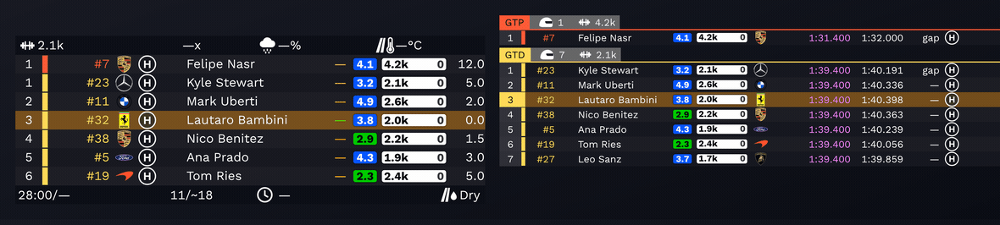
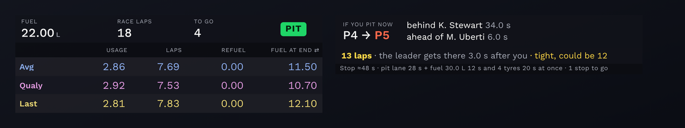
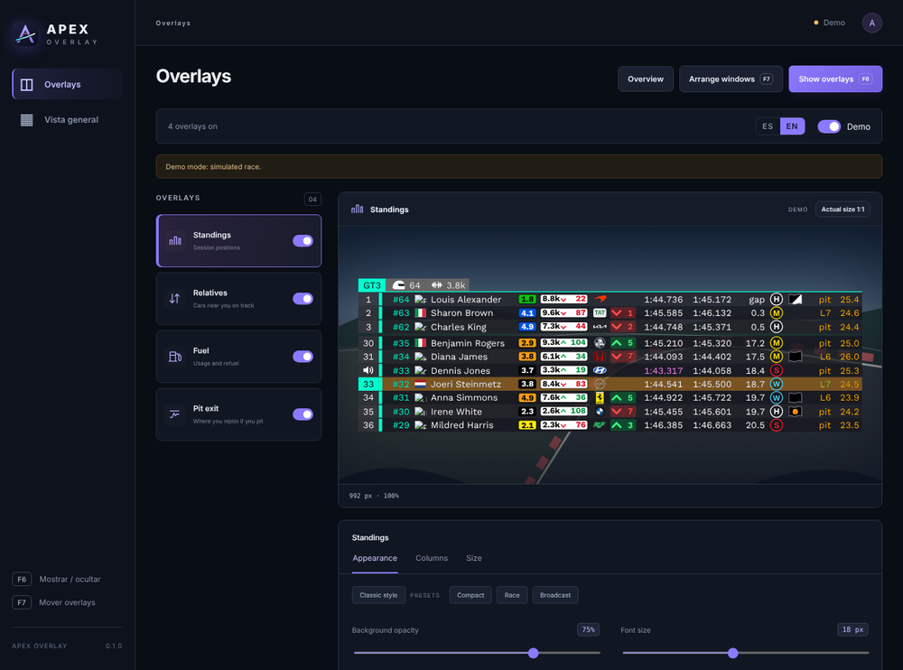
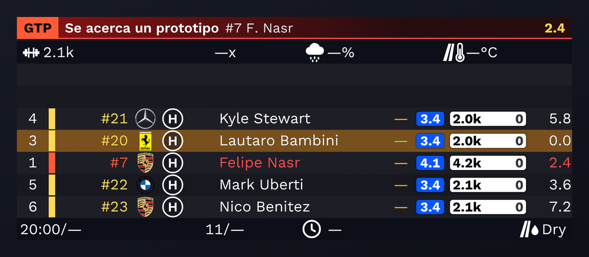
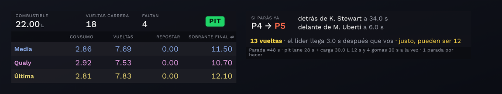
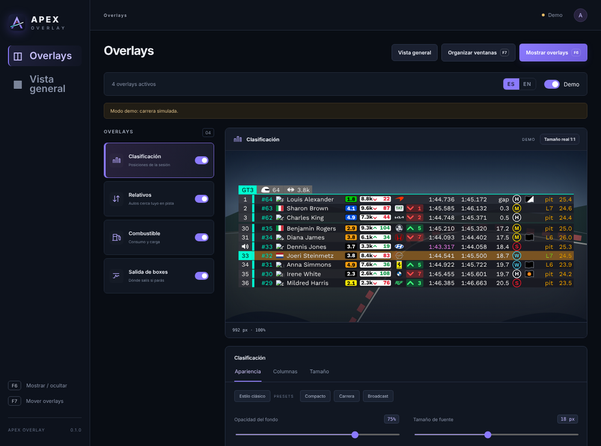

# Apex Overlay

English · [Español](#apex-overlay-español)

Live timing overlays for iRacing: standings, relatives, a fuel calculator and a pit‑strategy panel. It reads the game directly, sits on top of it, and runs in English or Spanish.

## Download and run

Open the [Releases](../../releases) section, download the latest `ApexOverlay-x.y-win64.zip`, unzip it anywhere and run `ApexOverlay.exe`. There is nothing to install.

The first time, Windows may show a blue "Windows protected your PC" box because the app is not signed. Click "More info" and then "Run anyway".

It needs Windows 10 or 11 and iRacing.

## What it shows

**Standings and relative.** The full order grouped by class, and the cars right around you on track with live gaps. In a multiclass race it warns you when a faster car is about to lap you.

**Fuel and pit strategy.** Fuel on board, usage per lap and laps left, how much to add, and where you would come out if you pit now. It also figures out how many laps the race will really be for your class and keeps that updated, including the time a stop costs (pit lane plus fuel and tyres).

## Setting it up

Everything is set from a single window. Press **F6** to show or hide the overlays and **F7** to drag them onto your monitor wherever you want them. In the editor you can drag the columns to reorder them, choose what each panel shows, and change size and opacity. The **Demo** switch fills the overlays with a simulated race so you can arrange everything without being in a session.

If you have any issues, please contact me on discord.
.lauti

---

# Apex Overlay (Español)

[English](#apex-overlay) · Español

Overlays de tiempos en vivo para iRacing: clasificación, relativos, calculadora de combustible y un panel de estrategia de boxes. Lee el juego directamente, se muestra encima y funciona en inglés o español.

## Descargar y abrir

Entrá a [Releases](../../releases), bajá el último `ApexOverlay-x.y-win64.zip`, descomprimilo donde quieras y abrí `ApexOverlay.exe`. No hay que instalar nada.

La primera vez, Windows puede mostrar un cartel azul ("Windows protegió tu PC") porque la app no está firmada. Tocá "Más información" y después "Ejecutar de todas formas".

Necesita Windows 10 u 11 e iRacing.

## Qué muestra

**Clasificación y relativo.** El orden completo agrupado por clase, y los autos que tenés cerca en pista con los gaps en vivo. En multiclase te avisa cuando un auto de una clase más rápida está por doblarte.

**Combustible y estrategia.** Combustible a bordo, consumo por vuelta y vueltas que te quedan, cuánto cargar, y dónde salís si parás ahora. Además calcula cuántas vueltas va a ser la carrera para tu clase y lo mantiene al día, con el tiempo que cuesta la parada (pit lane más combustible y gomas).

## Cómo se usa

Todo se configura desde una sola ventana. **F6** muestra u oculta los overlays y **F7** te deja arrastrarlos sobre tu monitor. En el editor podés arrastrar las columnas para reordenarlas, elegir qué muestra cada panel y cambiar el tamaño y la opacidad. El interruptor **Demo** llena los overlays con una carrera simulada para acomodar todo sin estar en una sesión.

Si tienes algun problema contactame en discord.
.lauti
